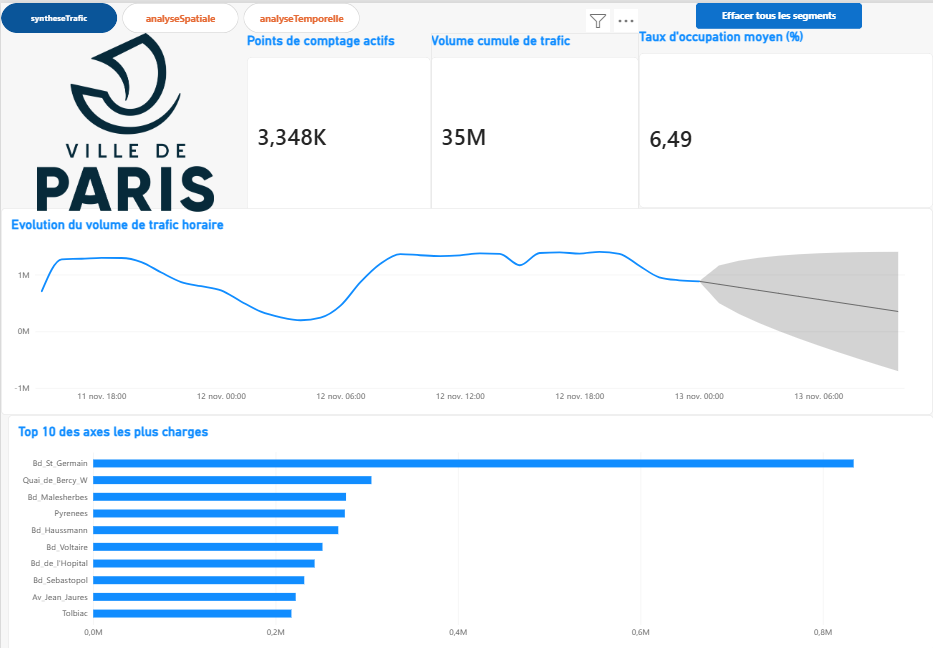
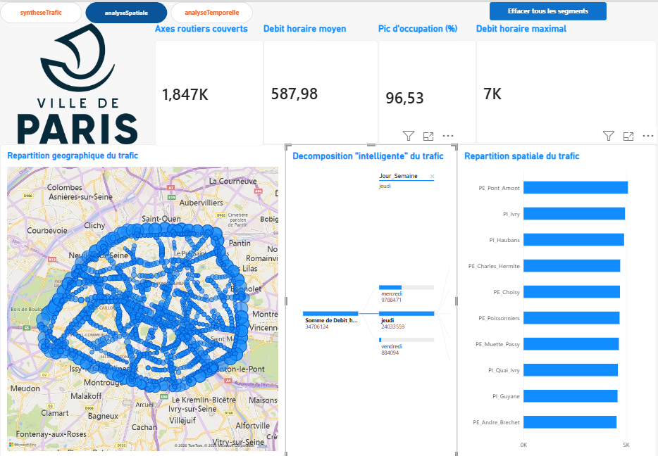
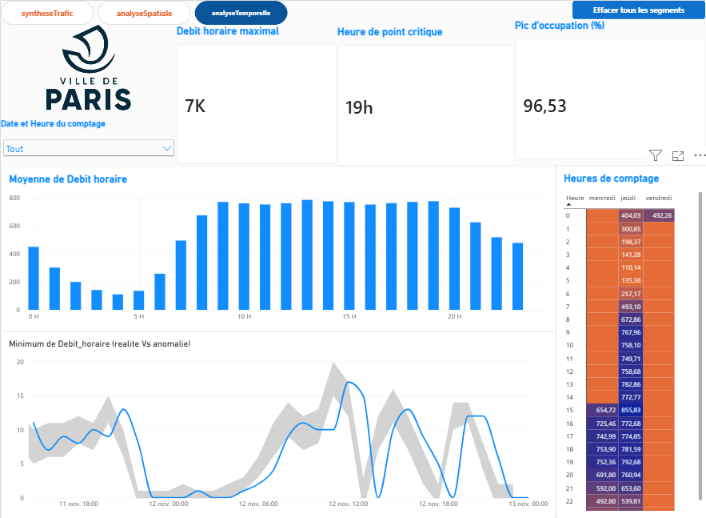

# 🚦 Tableau de Bord - Analyse du Trafic Routier Parisien

> Projet de Business Intelligence & Data Engineering visant à analyser, modéliser et restituer les flux de circulation de la ceinture parisienne (Périphérique Intérieur/Extérieur).

---

## 📌 Aperçu du Dashboard

### 1. Macro Synthèse & Prévisions (Page 1)
*Description rapide de la vue macro et des choix techniques.*


### 2. Analyse Spatiale & Cartographie (Page 2)
*Mise en valeur de la répartition géographique des capteurs et des pics d'occupation.*


### 3. Analyse Temporelle & Indicateurs Critiques (Page 3)
*Mise en avant des mesures DAX temporelles (`Heure_Pointe_Critique`, `Debit_Max_Horaire`, `Heures_Saturees`).*


## 🛠️ Stack Technique & Architecture
* **Source des données :** Open Data Paris (`comptages-routiers-permanents`).
* **Stockage & ETL :** MySQL 8.0, Talend Open Studio (pipelines de transformation).
* **Restitution & DAX :** Microsoft Power BI (Modélisation en étoile, mesures DAX avancées).

## 💡 Extraits de code DAX clés (`/dax`)
``` DAX
Exemple de mesure calculée pour l'heure de pointe critique :
Heure_Pointe_Critique = 
VAR HeureMax = 
    CALCULATE(
        SELECTEDVALUE('ta_table'[Heure_Comptage]),
        TOPN(
            1,
            ALL('ta_table'[Heure_Comptage]),
            CALCULATE(SUM('ta_table'[Debit_h])),
            DESC
        )
    )
RETURN
    IF(NOT(ISBLANK(HeureMax)), FORMAT(HeureMax, "00") & "h", "N/A")
```

## 💡 Focus Technique : Logique DAX

En tant que profil orienté Data Engineering & SQL, la modélisation tabulaire sous Power BI a été un terrain d'exploration passionnant. Voici un aperçu de trois mesures clés implémentées pour piloter l'analyse temporelle et critique :

* **`Heure_Pointe_Critique`** : Isole l'heure enregistrant le pic maximal de trafic global à l'aide d'un classement (`TOPN` trié par débit décroissant) et met en forme le résultat textuel (`FORMAT` en heures).
* **`Debit_Max_Horaire`** : Équivalent d'un `SELECT MAX()` global, cette mesure utilise un `MAXX` couplé à un `ALL()` pour s'affranchir des filtres de contexte et capturer le débit maximal absolu de la ceinture parisienne.
* **`Heures_Saturees`** : Exploite un `DISTINCTCOUNT` filtré via l'opérateur `IN` pour dénombrer précisément le volume horaire critique où l'état du trafic bascule en "Saturé" ou "Bloqué".
